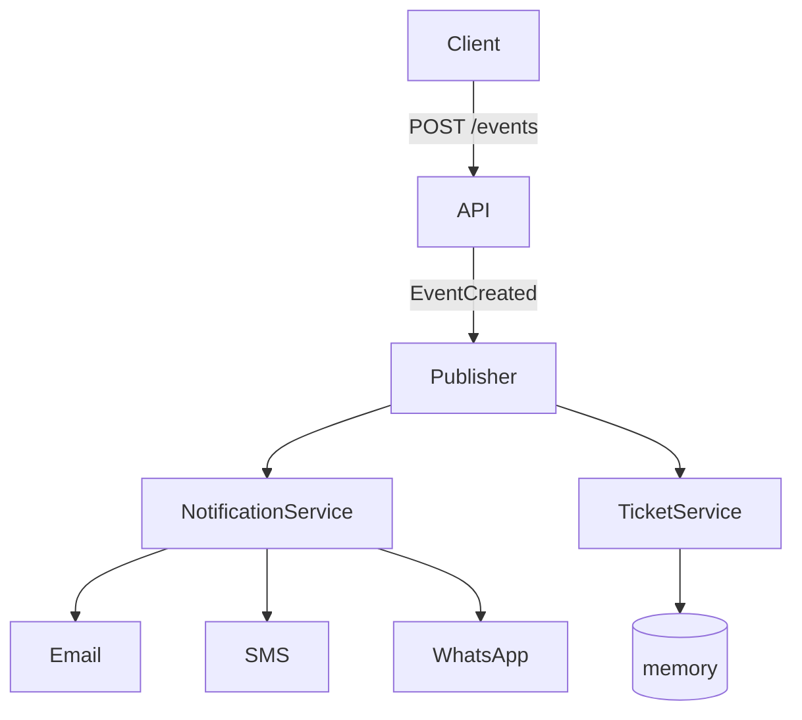

# event-driven-fastapi

Small event-driven app with FastAPI. When an event is created the API publishes
`EventCreated` and the subscribers handle it. Data is kept in memory, no DB or broker.

## Diagram



- `main.py` - the endpoints
- `publisher.py` - publisher + `Subscriber` base class
- `notifications/channels.py` - `NotificationChannel` base class and the channels
- `subscribers/` - notification service and ticket service
- `container.py` - creates everything and registers the subscribers

## Running

```bash
python3 -m venv .venv
.venv/bin/pip install -r requirements.txt
.venv/bin/uvicorn app.main:app --reload
```

Docs at http://localhost:8000/docs

```bash
curl -X POST localhost:8000/events -H 'Content-Type: application/json' \
  -d '{"name":"Concert","attendee_email":"a@b.com","attendee_phone":"+962700000000"}'
```

Tests: `.venv/bin/pytest`

## Adding a subscriber

Make a class that extends `Subscriber` and implement `handle`:

```python
class AnalyticsService(Subscriber):
    def handle(self, event):
        print("new event", event.name)
```

Then register it in `container.py`:

```python
self.publisher.subscribe(AnalyticsService())
```

## Adding a notification channel

Extend `NotificationChannel`, give it a name and say who receives it:

```python
class TelegramChannel(NotificationChannel):
    name = "telegram"

    def recipient(self, event):
        return event.attendee_phone
```

Add it to the channels list in `container.py`. Nothing else changes, the
notification service just loops over the channels it gets.

## Notes

- The publisher doesn't know the concrete subscribers, only the base class.
- The container is passed with `Depends` so the tests can use a fresh one.
- Ticket service won't reserve twice for the same event id.
- Subscribers run one after another (sync). Fine for this, a real app would use a broker.
